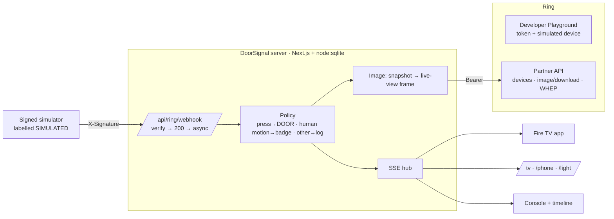

# DoorSignal

**When your Ring doorbell is pressed, the screen you're watching tells you — and motion doesn't.**

DoorSignal is a visual-first doorbell alert for Deaf and hard-of-hearing households. A Ring
`button_press` becomes a full-screen alert, with the latest Ring camera image, on the TV and every
other paired screen. Motion never raises a door alert. Acknowledge once with the remote's OK button
and every screen clears.

Built for the Amazon Developer Hackathon 2026 — **Ring** track (primary) and **Fire TV** track.

> Hackathon prototype. Not a safety or emergency device. No face recognition.

---

## The problem

- Ring sells no light or vibration accessory for Deaf users. Ring's community has a long-running
  request ([thread](https://community-ring.sprinklr.com/t/flashing-or-strobing-light-system-for-hearing-impaired/7715)).
- The common workaround — IFTTT / Alexa routines that flash smart lights — is reported in that thread
  to lag 15–30 s and to fire on motion as well as presses.
- Phone accessibility features (iOS Sound Recognition, Android Sound Notifications) help only when the
  phone is on you and can hear the chime.

- Fire TV can already show a Ring **Picture-in-Picture** feed "in the top right corner of your TV
  screen" on "select Echo Show and Fire TV models"
  ([Ring support](https://ring.com/support/articles/k9l04/Viewing-Your-Cameras-on-Fire-TV-with-Alexa)),
  set up through Alexa doorbell *announcements*.

DoorSignal routes the press itself, not a sound, to the screen you are already looking at — and is
built for someone who can't hear the announcement: a **full-screen** alert that **stays until
acknowledged**, distinguishes a press from motion, and reaches **every** paired screen and light at
once, clearing everywhere with one OK. The Deaf users in the Ring thread were asking for visual
alerts while the corner PIP already existed; we have **not yet validated** DoorSignal with Deaf users.

## What is real and what is simulated

| Part | Status |
|---|---|
| Ring Partner API calls (`/v1/devices`, `/status`, `/capabilities`, `/media/image/download`, WHEP live view) | **Real** — `server/lib/ring/client.ts`, with Ring's required `User-Agent` and `Hardware_Id` headers |
| Webhook receiver: `X-Signature` HMAC-SHA256 over raw bytes, idempotent on `request_id`, 200 within 5 s | **Real** production code path — `server/app/api/ring/webhook/route.ts` |
| Doorbell presses and motion events in the demo | **Simulated.** The Ring Developer Playground streams video but cannot emit `button_press` or motion webhooks. The simulator builds payloads in Ring's documented format, signs them with our dev key and POSTs them to the real webhook. Every such event is labelled **SIMULATED** in the UI. |
| Alert images | **Real Ring media** when a Playground token is set (snapshot API, or a frame from the Ring live view). Without a token the UI says "No image available" — it never shows a placeholder as if it were a camera image. |
| Replay mode (hosted judge sandbox) | Serves responses **recorded from the real Playground** by `npm run capture` (Playground tokens expire after ~30 min). Labelled **REPLAY**. |
| Fire TV app | **Real Fire OS app** (`firetv/`). Built with `./gradlew assembleDebug`. See limitations for what has and hasn't been verified on a device. |

## Amazon technology used — and where it runs

| Technology | Where in the running app |
|---|---|
| Ring Developer Playground | Token for all live Ring calls; simulated Package/Vehicle/Motion live-view streams |
| Ring Partner API — devices, status, capabilities | Console → "1 · Ring" → Find devices (`app/api/ring/devices`) |
| Ring Partner API — image snapshot (`POST /media/image/download`, 303 → pre-signed URL) | Image on every alert (`lib/media.ts`) |
| Ring Partner API — WHEP live view (`recvonly`, offer after ICE gathering) | Console live view; frames are the fallback alert image (`app/Console.tsx`, `app/api/ring/stream`) |
| Ring webhook contract (`button_press`, `motion_detected.sub_type`, HMAC `X-Signature`) | `app/api/ring/webhook`, `lib/ring/hmac.ts`, `lib/ring/schemas.ts` |
| Fire TV (Fire OS): leanback launcher, foreground service, Android notifications, D-pad | `firetv/app/src/main/java/com/doorsignal/firetv/` |

## Architecture



## Run it locally

Requirements: Node.js 22 (uses the built-in `node:sqlite`), npm.

```bash
cd server
cp .env.example .env.local      # then set ADMIN_PASSWORD, SESSION_SECRET, RING_HMAC_KEY
npm ci
npm run dev                     # http://localhost:3000
```

| Variable | Purpose |
|---|---|
| `ADMIN_PASSWORD` | Console login |
| `SESSION_SECRET` | Signs sessions and expiring image links |
| `RING_HMAC_KEY` | Verifies webhook `X-Signature`. In the hackathon this is our own dev key (shared with the simulator). |
| `RING_HMAC_KEY_SOURCE` | Set to `ring` **only** when the key above was issued by Ring. Otherwise every event is labelled SIMULATED. |
| `RING_ACCESS_TOKEN` | Optional Playground token (can be pasted in the console instead; held in memory only) |
| `DOORSIGNAL_MODE` | `live` or `replay` |
| `IMAGE_TTL_MIN` | Minutes before alert images are deleted (default 60) |

### Demo flow (about 2 minutes)

1. Open `http://localhost:3000`, log in.
2. **1 · Ring:** paste a token from the [Ring Developer Playground](https://developer.amazon.com/ring/console/playground) → Find devices → Use.
3. Open `/tv` in another window (or the Fire TV app). It shows a 6-digit code. **2 · Screens:** type it → Pair.
4. Optional: **Start live view**, and press *Package* in the Playground, so alerts carry a live frame.
5. **3 · Try it:** *Doorbell press* → the TV shows **DOORBELL** with the image. Press Enter/OK → every screen clears.
6. *Bird / other motion* → nothing on screen; the timeline shows **LOG ONLY**.

### Replay mode (hosted judge sandbox)

```bash
RING_ACCESS_TOKEN=<Playground token> npm run capture   # records real Playground responses
DOORSIGNAL_MODE=replay npm run start
```

In replay mode anyone can open the console, `/tv`, and press *Doorbell press* (rate limited) without
a Ring token. Pairing a screen still needs the admin password.

### Fire TV app

```bash
cd firetv
echo "sdk.dir=$ANDROID_HOME" > local.properties
./gradlew assembleDebug -Pdoorsignal.serverUrl=http://<your-computer-ip>:3000
adb connect <fire-tv-ip> && adb install -r app/build/outputs/apk/debug/app-debug.apk
```

On the Android TV emulator the default server URL `http://10.0.2.2:3000` reaches your computer.
Launch DoorSignal from Apps, choose *Get pairing code*, and approve the code in the console.

## Tests

```bash
cd server
npm run typecheck && npm run lint
npm test            # 28 unit tests: HMAC, schemas, policy, webhook route, ack, retention, labelling
npm run build
npm run test:e2e    # Playwright: core journey + 50-press latency run against the production build
```

## Privacy and security

- **No face recognition** and no identification of people (Ring Appstore policy §4.2.2). Images are
  shown only as "the latest camera image".
- Ring tokens are kept **in memory only** and never logged or stored. Surface tokens are stored hashed.
- Webhooks are rejected unless `X-Signature` verifies over the raw body (constant-time compare).
- Alert images are deleted after `IMAGE_TTL_MIN`; **Delete my data** removes every event and image.
- Image links are signed and expire after 10 minutes.
- Flashing is 2 Hz (below the 3 Hz photosensitivity threshold) and stops when the OS asks for reduced motion.

## Known limitations

- **No real Ring doorbell events yet.** The Playground cannot send `button_press` webhooks, so presses
  are simulated (and labelled). Real events need a certified Ring app, a Ring-issued signing key,
  US-located devices and a Ring base plan.
- **Ring production latency is unknown.** Our measured p50/p95 (≈10–15 ms) is local loopback from
  webhook receipt to render — it does not include Ring's delivery time.
- **Fire TV:** the app compiles, but has **not yet been run on a Fire OS device or emulator**. Whether a
  heads-up/full-screen notification appears over another app's playback on Fire OS is unverified.
- Snapshot availability for the Playground device is unverified; the live-view frame is the fallback.
- Ring warns that datacenter IPs may receive HTTP 406; a hosted *live* mode may need Ring to allowlist
  the egress IP. Replay mode is unaffected.
- Single household, single server instance (in-process SSE hub). The Fire TV app allows cleartext HTTP
  for LAN prototyping; production must use HTTPS.

## License and attribution

MIT — see [LICENSE](LICENSE). Third-party notices: [THIRD_PARTY_NOTICES.md](THIRD_PARTY_NOTICES.md).
